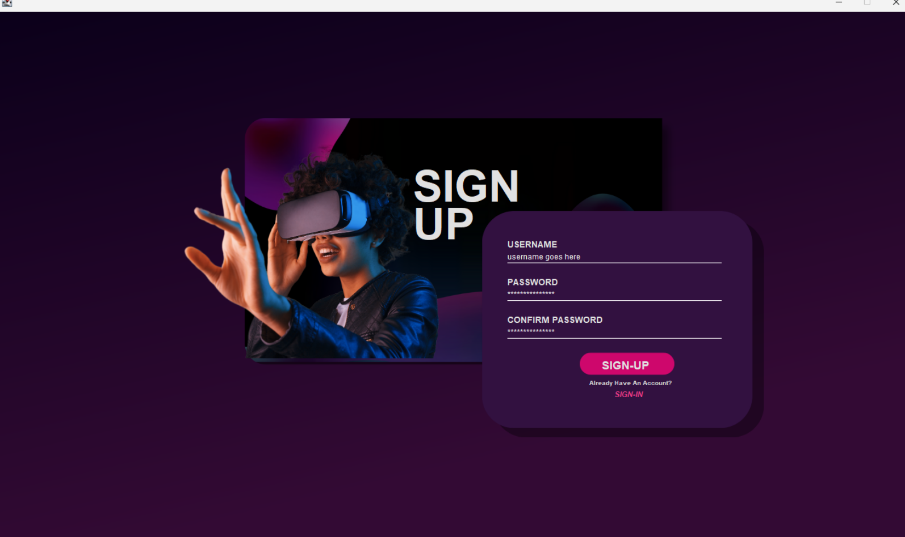
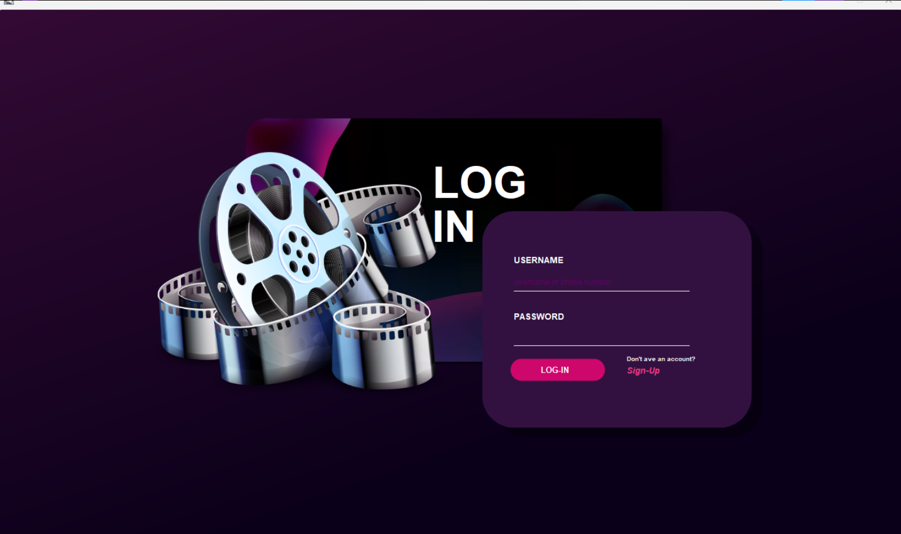
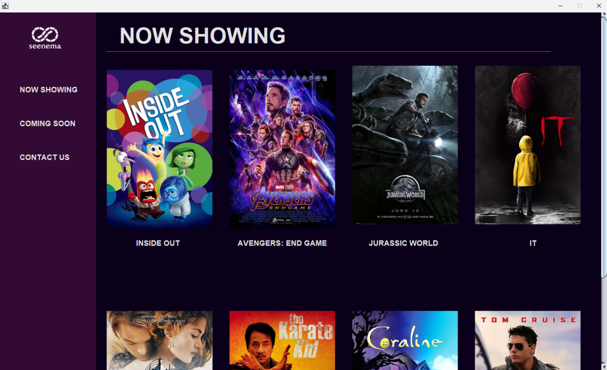
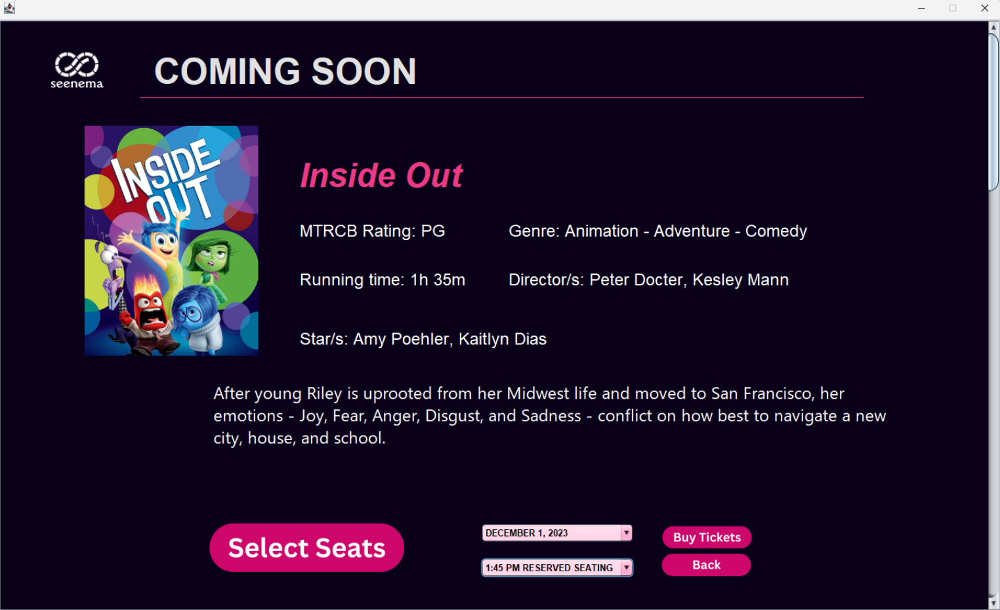
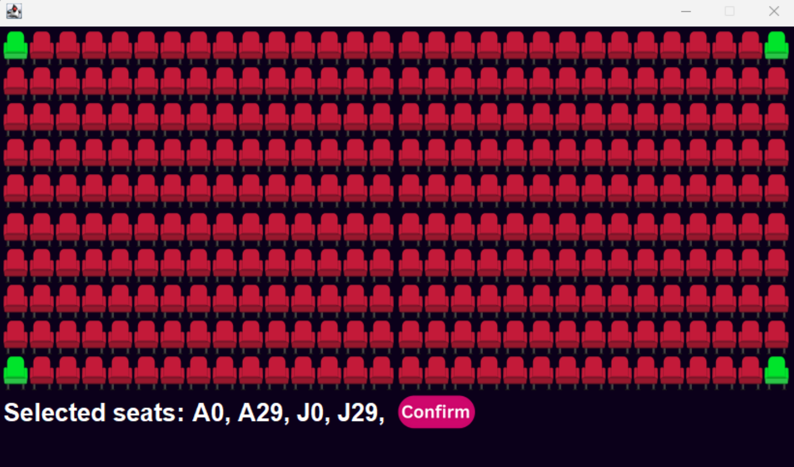
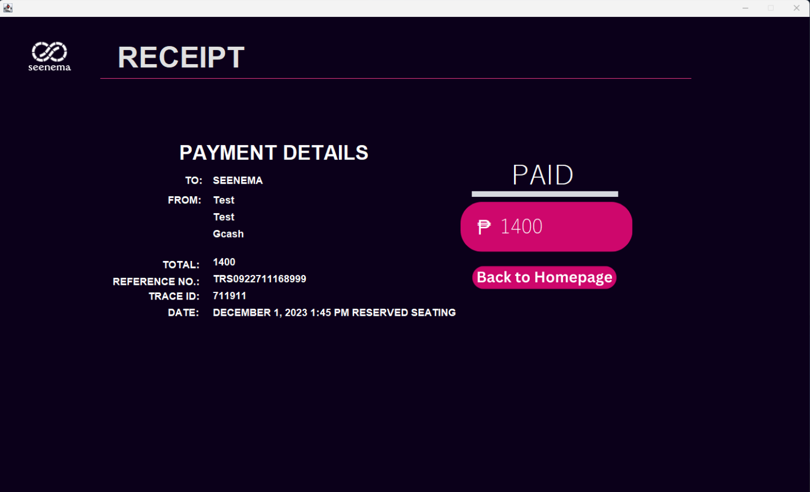

# Movie Booking System

---

# Overview
A **Movie Reservation System** made during my Sophomore year.
It was designed to follow the MVC architecture where:

- **Model:** Handles core data and application logic.  
- **View:** Displays data through Swing-based UI components.  
- **Controller:** Connects user actions to model updates and view changes.

The interface was built using a mix of **built-in and custom Swing components**, allowing users to:
- Select a movie, seat, date, and time  
- Confirm bookings with a payment method  

---

# Preview

  
  &nbsp;&nbsp;&nbsp;
  

  
  &nbsp;&nbsp;&nbsp;
  

  
  &nbsp;&nbsp;&nbsp;
  

---
